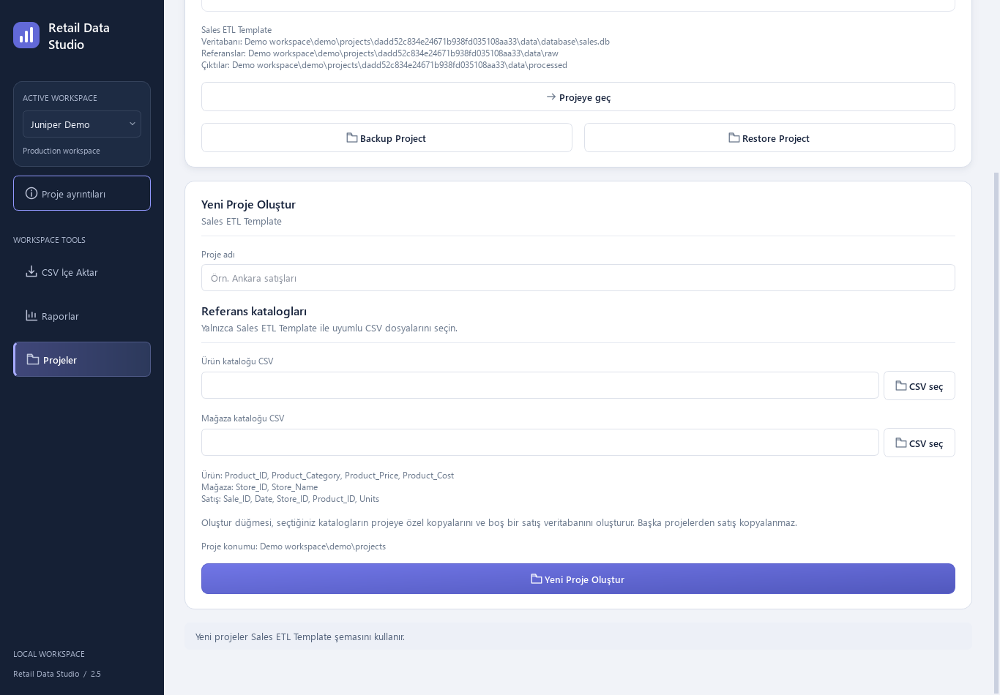
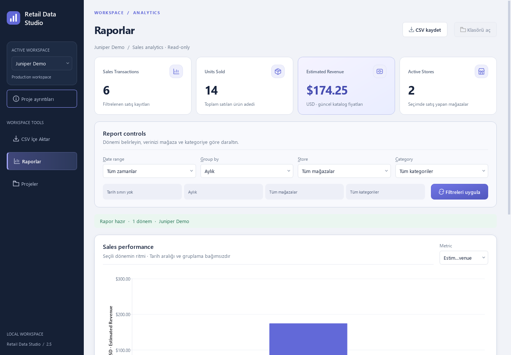

# Retail Data Studio

**A Windows desktop application for structured retail sales ETL and reporting.** Import sales CSVs, validate records against product and store catalogs, maintain separate SQLite projects, and explore sales performance through interactive reports.

**Built with:** Python 3.12 · pandas · SQLite · PySide6 / Qt Widgets · Matplotlib (QtAgg)  
**Version:** 2.5 · Windows 10/11 (64-bit)

## Application preview

### 1. Create and manage projects

Each project has its own product and store catalogs, SQLite database, and reporting outputs.



### 2. Explore sales performance

View key metrics, group results by period, and filter by date, store, or product category.



## Features

- **Validated CSV imports:** Check sales against product and store catalogs and separate rejected rows.
- **Incremental loading:** Identify sales by `Sale_ID`, skip previously imported identical records, and report conflicting values.
- **Isolated workspaces:** Maintain independent projects with their own catalogs, databases, and outputs.
- **Sales reporting:** Filter by date, store, and category; aggregate by period; export reports to CSV.
- **Backup and restore:** Export a project as `.rdsbackup` and restore it as a new project without overwriting the original.

> **Scope:** Retail Data Studio uses the specific sales CSV schema documented below. It is **not** a general-purpose ETL tool for arbitrary CSV structures.

## Run from source

Requirements: **Windows 10/11 x64** and **Python 3.12**. From the repository root, run:

```powershell
py -3.12 -m venv .venv
.\.venv\Scripts\python.exe -m pip install -r requirements-dev.txt
.\.venv\Scripts\python.exe scripts/run_studio.py
```

Alternatively, run `setup.bat`, followed by `run_gui.bat`.

The source launcher uses managed projects rather than legacy development database profiles. Locally created projects are stored under the ignored `data/projects/` directory. Keep personal backups outside the project directory and never commit real data.

## Try it with synthetic data

The repository includes three sample files in [`examples/`](examples/): `products.csv`, `stores.csv`, and `sales_sample.csv`.

1. Open **Projeler** and create a project with `examples/products.csv` and `examples/stores.csv`.
2. Go to **CSV İçe Aktar**, select `examples/sales_sample.csv`, and start processing.
3. Open **Raporlar**, choose **Tüm zamanlar**, and apply the filters.
4. Verify the result: **6 transactions, 14 units, and 174.25 estimated revenue**.
5. Import the same sales CSV again. **0 new records** should be added.
6. Export a report, then try **Backup Project** and **Restore Project** with a new name.

All example names, IDs, and values are synthetic. The interface primarily uses Turkish navigation, with some English Backup/Restore labels. See the [Quick Start guide](docs/QUICK_START.md).

## Expected CSV schema

Provide UTF-8 CSV files with comma separators and the following columns:

| File | Required columns | Optional columns |
| --- | --- | --- |
| `products.csv` | `Product_ID`, `Product_Category`, `Product_Price`, `Product_Cost` | `Product_Name` |
| `stores.csv` | `Store_ID`, `Store_Name` | `Store_Location` |
| Sales CSV | `Sale_ID`, `Date`, `Store_ID`, `Product_ID`, `Units` | — |

**Validation rules:** IDs must be positive integers, catalog IDs must be unique, and each sale must reference an existing product and store. `Units` must be a positive whole number. Dates use `YYYY-MM-DD`. Prices use a period decimal separator and may have a `$` prefix. Use a single currency per project.

**Revenue caveat:** Estimated revenue is calculated using units sold × **current catalog price**. It does not represent historical receipts, taxes, discounts, or accounting revenue.

## Backup and restore

A `.rdsbackup` contains a consistent SQLite snapshot, catalogs, project configuration, version metadata, and integrity hashes. Restoring creates a **separate project** with a new ID; it does not overwrite the original.

Original input CSVs, logs, quarantine files, operation history, and previously exported reports are **not** included. Reports can be regenerated, and backups are **not encrypted**. See [backup scope](docs/BACKUP_RESTORE_V24.md).

## Development and packaging

Run the automated tests:

```powershell
.\.venv\Scripts\python.exe -m pytest tests -q
```

Run the focused synthetic example test:

```powershell
.\.venv\Scripts\python.exe -m pytest tests/test_synthetic_example.py -q
```

For a future local Windows build, install `requirements-build.txt` and run `build_portable.bat`. See the [packaging guide](docs/PACKAGING.md).

Build outputs, virtual environments, private data, and local acceptance artifacts are excluded via `.gitignore`. The accepted Windows Setup is stored separately from this public source repository; **no EXE or Setup files are distributed here**.

## Limitations and licensing

Retail Data Studio is a local desktop application, not a multi-user server or accounting system. It has no automatic cloud synchronization or application updater. Native Windows dialogs and physical display scaling remain separate manual-verification items.

**Commercial redistribution of the Windows installer has not received final license clearance.** The Qt/PySide6 LGPL source and notice supplement has been prepared, but remaining build-source, library-replacement evidence, and legal conditions are described in the [license status](docs/FINAL_LICENSE_STATUS.md) and [closure report](docs/LICENSE_CLOSURE.md). No commercial Qt entitlement is assumed.

**This repository is publicly viewable, but no license has yet been selected for the application source code.** Public availability alone does not grant reuse or redistribution rights.
